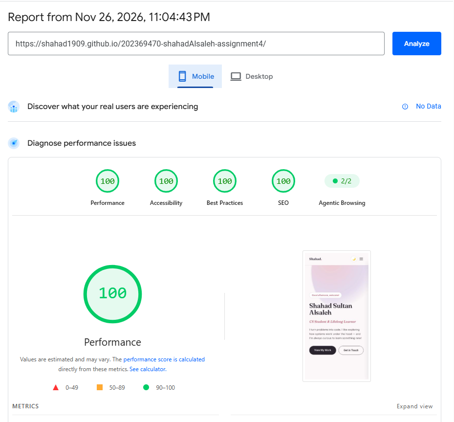
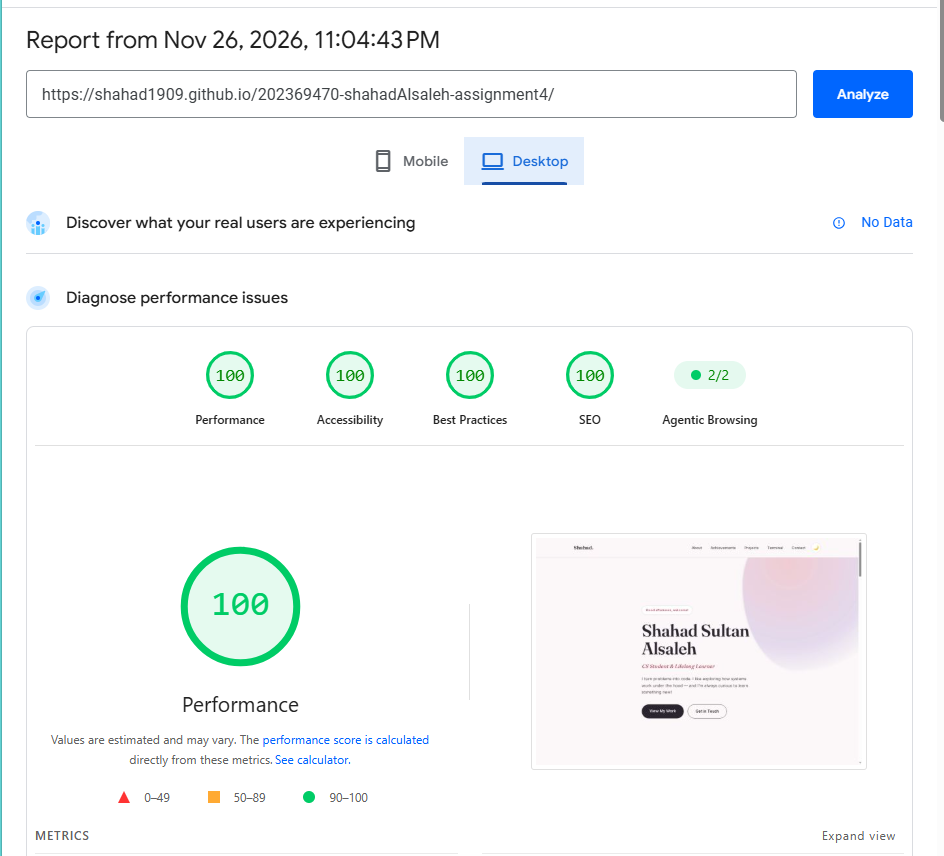
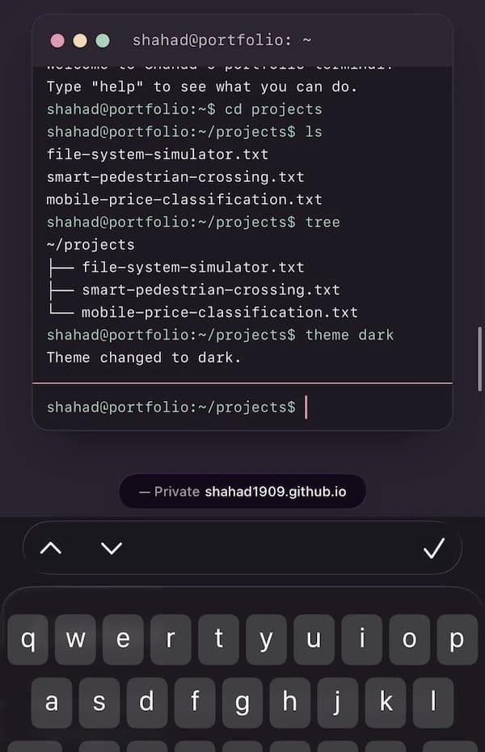

# Shahad Sultan Alsaleh — Personal Portfolio (Assignment 4)

🔗 **Live site:** https://shahad1909.github.io/202369470-shahadAlsaleh-assignment4/

## Project Description

This is my personal portfolio website and the final step of the
web development course assignments. It brings together everything from
Assignments 1–3 (responsive layout, dark/light theme, live GitHub data,
project filter and sort, and a validated contact form) and adds one new
creative feature: an **interactive terminal**.

The terminal is a web version of my Java
[File System Simulator](https://github.com/shahad1233/File-System-Simulator)
project. Instead of a real disk, its files are my portfolio: visitors can
type `ls`, `cd`, `cat`, `tree`, and `grep` to explore my background,
skills, and projects, just like in a Linux shell.

I chose this idea because it connects my portfolio to one of my own projects, the File System Simulator I built in Java. I wanted visitors to actually try the same commands (ls, cd, cat, tree, grep) in the browser instead of just reading about the project, and it was a good chance to rebuild the same idea in JavaScript.

The site is built with plain **HTML, CSS, and JavaScript**, with no
frameworks, libraries, or backend, and scores **100** in all four
Lighthouse categories on both mobile and desktop.

### Sections
- **About Me**: a short introduction, background, skills, and hobbies.
- **Achievements**: academic honors and test scores.
- **Projects**: three featured projects with filter, sort, live GitHub
  info, and a language breakdown.
- **Terminal** *(new)*: explore the portfolio with shell commands.
- **Contact**: a form with client-side validation.

---

## What's New in Assignment 4

| Feature | What it does |
|---|---|
| **Interactive terminal** | 11 commands (`help`, `ls`, `cd`, `pwd`, `cat`, `tree`, `grep`, `theme`, `open`, `history`, `clear`) over a small file system built from my portfolio content. |
| **Shell-like experience** | The prompt shows the current folder, ↑/↓ recall earlier commands, and Tab completes commands, file names, and link names. |
| **Connected to the site** | `theme dark` changes the theme of the whole page (and is remembered), and `open` opens my projects on GitHub. |
| **Helpful errors** | Wrong commands or paths show a clear message (e.g. `cd: about.txt: Not a directory`) instead of breaking. |
| **Accessible** | Results are announced to screen readers, the input has a label, and Tab only completes when there is text, so keyboard users can still leave the terminal. |
| **Polish & fixes** | A border makes the terminal visible in dark mode, the message box only resizes vertically, and form fields no longer cause zoom on iPhone. |


---

## User Guide

### Using the terminal

Scroll to the **Terminal** section (or click **Terminal** in the menu),
click inside the dark window, and start typing. Press **Enter** to run a
command.

**New to terminals? Try these three commands in order:**

1. `ls` — see the files you can read
2. `cat about.txt` — read a file
3. `tree` — see everything at once

### All commands

| Command | What it does | Example |
|---|---|---|
| `help` | Lists every command with a short description | `help` |
| `ls` | Lists the files and folders (folders end with `/`) | `ls`, `ls projects` |
| `cd` | Moves into a folder (`..` goes back, `cd` alone goes home) | `cd projects`, `cd ..` |
| `pwd` | Shows the folder you are in | `pwd` |
| `cat` | Shows the content of a file | `cat skills.txt` |
| `tree` | Shows all files and folders as a tree | `tree` |
| `grep` | Searches every file for a word (not case-sensitive) | `grep java` |
| `theme` | Changes the site theme (alone, it switches) | `theme dark`, `theme` |
| `open` | Opens a project or my GitHub profile in a new tab | `open github` |
| `history` | Lists the commands you typed | `history` |
| `clear` | Clears the screen | `clear` |

### Tips

- **Tab** completes what you are typing: `he` → `help`,
  `cat ab` → `cat about.txt`. If there are several matches, they are all
  listed.
- **↑ / ↓** bring back the commands you typed before.
- You can reach a file in another folder without `cd`:
  `cat projects/file-system-simulator.txt`.
- The prompt always shows where you are, e.g.
  `shahad@portfolio:~/projects$`.
- If you type something wrong, the terminal tells you what happened,
  e.g. `cd abc` → `cd: abc: No such file or directory`.
- Keyboard users: when the input is empty, **Tab** moves on to the
  contact form as usual.
- **On a phone:** tap the dark window to open the keyboard. Phone
  keyboards have no Tab or arrow keys, so type the full command.

### Using the rest of the site

- **Theme:** the 🌙 / ☀️ button in the top bar (or `theme` in the
  terminal). Your choice is remembered.
- **Projects:** use the filter buttons and the **Sort by** menu; your
  choices are remembered. Click **Show more** for each project's
  challenge and lessons.
- **Contact:** fill in all three fields; each field tells you what is
  missing before you send.

### Features carried over from Assignments 1–3
### Features carried over from Assignments 1–3
- The layout is fully responsive and works on desktop, tablet, and mobile (using Flexbox and Grid).
- A dark / light theme that is saved in `localStorage`.
- The projects can be filtered (All, Software, Hardware, Machine Learning) and sorted
  (Newest, Oldest, Name A–Z) at the same time, and the site remembers these choices
  on the next visit.
- Each project shows its GitHub dates and language breakdown, with a loading
  message, and a friendly error message with a **Try again** button if something goes wrong.
- Each project can be expanded to show "Biggest challenge" and "What I learned".
- The contact form checks the fields while typing, has a character counter,
  and shakes the fields that are not valid.
- A visit timer, a greeting based on the time of day, smooth scrolling, and a
  hamburger menu on mobile.

### Accessibility
- All interactive elements are real `<button>` elements, so they work
  with the keyboard (Tab, then Enter or Space). Filter buttons and the
  sort menu show a clear outline when reached with the keyboard
  (`:focus-visible`).
- `aria-expanded`, `aria-controls`, `aria-pressed`, `aria-label`, and
  `aria-live` tell screen-reader users what each button does, which
  filter is selected, and when content changes.
- Light-mode text colors meet the **WCAG AA** contrast ratio (at least
  4.5:1), and the page content is inside a `<main>` landmark, so screen
  readers can jump straight to it.
- All animations are turned off for users who enable "reduce motion" in
  their device settings.
- **Terminal:** new results are read out by screen readers
  (`aria-live="polite"`), the input has an `aria-label`, and the
  decorative title bar and prompt are hidden from screen readers
  (`aria-hidden`).
- **No keyboard trap:** Tab only autocompletes when the terminal input
  has text, so keyboard users can always move on to the next element.
- The terminal input uses a 16px font, so iPhone Safari does not zoom in
  when it is focused (the contact form fields were fixed the same way).

---

## Lighthouse Results

I tested the live site with [PageSpeed Insights](https://pagespeed.web.dev)
after adding the terminal, and all the scores stayed the same.

| | Performance | Accessibility | Best Practices | SEO |
|---|---|---|---|---|
| **Mobile** | **100** | **100** | **100** | **100** |
| **Desktop** | **100** | **100** | **100** | **100** |

| Mobile | Desktop |
|---|---|
|  |  |

The Performance score can be a little different each time I run the test,
because it depends on the network speed at that moment.

---

## Testing & Compatibility

### Browsers and devices

I tested the live site on the three main browser engines:

| Browser | Engine | Device | Result |
|---|---|---|---|
| Google Chrome | Chromium | Windows laptop | ✅ Works |
| Microsoft Edge | Chromium | Windows laptop | ✅ Works |
| Mozilla Firefox | Gecko | Windows laptop | ✅ Works |
| Safari | WebKit | iPhone | ✅ Works |



### Terminal test cases

I wrote **44 test cases** to check every command, wrong inputs, paths,
the theme, the keyboard shortcuts (↑/↓, Tab), and the console. All of them
passed on the live site. You can find the full list in
[`docs/technical-documentation.md`](docs/technical-documentation.md#15-testing).

### Issues I found while testing (and fixed)

| Issue | Fix |
|---|---|
| In dark mode, the terminal window was hard to see because it blended with the page background. | I added a 1px border around the window. |
| The contact message box could be dragged wider than the form. | I used `resize: vertical` and `max-width: 100%`. |
| iPhone Safari zoomed in when I tapped a form field, because the font was smaller than 16px. | I changed the input font size to `1rem` (16px). |
| A phone screenshot I used in the docs was too big (≈270 KB). | I resized it to 600px wide and compressed it to ≈51 KB. |

---

## Setup Instructions

### Option 1: Open the live site
Visit https://shahad1909.github.io/202369470-shahadAlsaleh-assignment4/.
Nothing to install.

### Option 2: Run locally
No installation or build tools are required. This is a static website.

1. **Clone** this repository:
   ```bash
   git clone https://github.com/shahad1909/202369470-shahadAlsaleh-assignment4.git
   ```
2. **Navigate** into the project folder:
   ```bash
   cd 202369470-shahadAlsaleh-assignment4
   ```
3. **Open `index.html`** in your browser:
   - Double-click the file, **or**
   - Right-click it, choose "Open with", and pick your browser, **or**
   - Use the VS Code **Live Server** extension for auto-reload while editing.
4. **Check that it works:** scroll to the **Terminal** section, type
   `help`, and press Enter. You should see the list of commands.

> **Notes:**
> - An internet connection is needed for Google Fonts and the GitHub
>   data. Without it, the site (including the terminal) still works and
>   shows a friendly error message with a **Try again** button.
> - GitHub allows **60 API requests per hour** per network without
>   login, and each page load uses 6. If you refresh many times, the
>   GitHub info may be unavailable for a while; it comes back on its own.
>   The terminal does not use the GitHub API, so it is never affected.## Setup Instructions

### Option 1: Open the live site
Visit https://shahad1909.github.io/202369470-shahadAlsaleh-assignment4/.
Nothing to install.

### Option 2: Run locally
No installation or build tools are required. This is a static website.

1. **Clone** this repository:
   ```bash
   git clone https://github.com/shahad1909/202369470-shahadAlsaleh-assignment4.git
   ```
2. **Navigate** into the project folder:
   ```bash
   cd 202369470-shahadAlsaleh-assignment4
   ```
3. **Open `index.html`** in your browser:
   - Double-click the file, **or**
   - Right-click it, choose "Open with", and pick your browser, **or**
   - Use the VS Code **Live Server** extension for auto-reload while editing.
4. **Check that it works:** scroll to the **Terminal** section, type
   `help`, and press Enter. You should see the list of commands.

> **Notes:**
> - An internet connection is needed for Google Fonts and the GitHub
>   data. Without it, the site (including the terminal) still works and
>   shows a friendly error message with a **Try again** button.
> - GitHub allows **60 API requests per hour** per network without
>   login, and each page load uses 6. If you refresh many times, the
>   GitHub info may be unavailable for a while; it comes back on its own.
>   The terminal does not use the GitHub API, so it is never affected.

---

## Project Structure

```
202369470-shahadAlsaleh-assignment4/
├── README.md
├── index.html            (all sections, including the terminal)
├── .gitignore
├── css/
│   └── styles.css        (theme variables, layout, terminal styles)
├── js/
│   └── script.js         (all interactivity, including the terminal)
├── assets/
│   └── images/
├── docs/
│   ├── ai-usage-report.md
│   ├── technical-documentation.md
│   └── images/           (Lighthouse results and screenshots)
└── presentation/
    ├── slides.pdf
    └── demo-video.mp4
```

---

## Technologies Used
- **HTML5**: semantic structure (`header`, `main`, `section`, `footer`)
  and ARIA attributes for accessibility.
- **CSS3**: custom properties (variables) for theming, Flexbox, Grid,
  transitions, and `@keyframes` animations.
- **JavaScript (ES6+)**: DOM events (`submit`, `keydown`, `click`),
  `localStorage`, `fetch` with `async/await`, `Promise.allSettled`,
  array methods (`map`, `sort`, `filter`, `reduce`, `slice`, `includes`),
  `setInterval`, and for the terminal: recursion (`tree`, `grep`),
  destructuring with rest (`const [name, ...args]`), `Object.hasOwn`,
  `Object.keys` / `Object.entries`, `padStart` / `padEnd`, and
  `textContent` instead of `innerHTML` to prevent XSS.
- **GitHub REST API**: public repository data and language statistics
  (no authentication needed).
- **Google Fonts**: Fraunces (headings) and Inter (body text).
- **GitHub Pages**: hosting for the live site.
- **PageSpeed Insights / Lighthouse**: performance and accessibility testing.

Full technical details are in
[`docs/technical-documentation.md`](docs/technical-documentation.md).

---

## AI Usage Summary

For this assignment I used **Claude (Anthropic)** as a step-by-step
tutor, just as I did in Assignment 3. For each part, Claude first
explained the idea in Arabic and then gave me code with blanks for me
to complete. Before every commit, it reviewed what I had written. When
a step felt too large, I asked Claude to break it into smaller pieces
and explain them the way a teacher would. That way I understood the
work instead of only getting it done.

What I decided and did myself:
- I came up with the **terminal idea** and linked it to my own Java
  File System Simulator project.
- I chose to put the terminal in its own **section** on the page
  instead of opening it from a pop-up button.
- I **found a bug during testing**: the message box could be dragged
  outside the form.
- I ran every test on my own devices (browsers on Windows and my
  iPhone), took and compressed the screenshots, and wrote the personal
  motivation section of this README.

Claude also drafted parts of the documentation and the slides. I
reviewed and edited them. Every commit made with AI help is marked
with `Assisted-by: Claude (Claude Opus 5.5)`.

The full list of tools, the benefits, challenges and learning outcomes,
the usage log, and the declaration are in
[`docs/ai-usage-report.md`](docs/ai-usage-report.md).

---

## Author

**Shahad Sultan Alsaleh** (Student ID: 202369470)